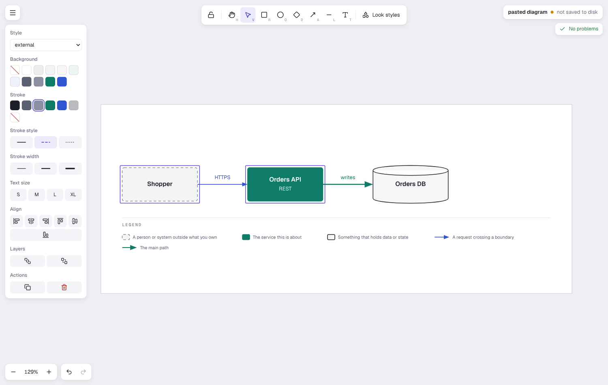
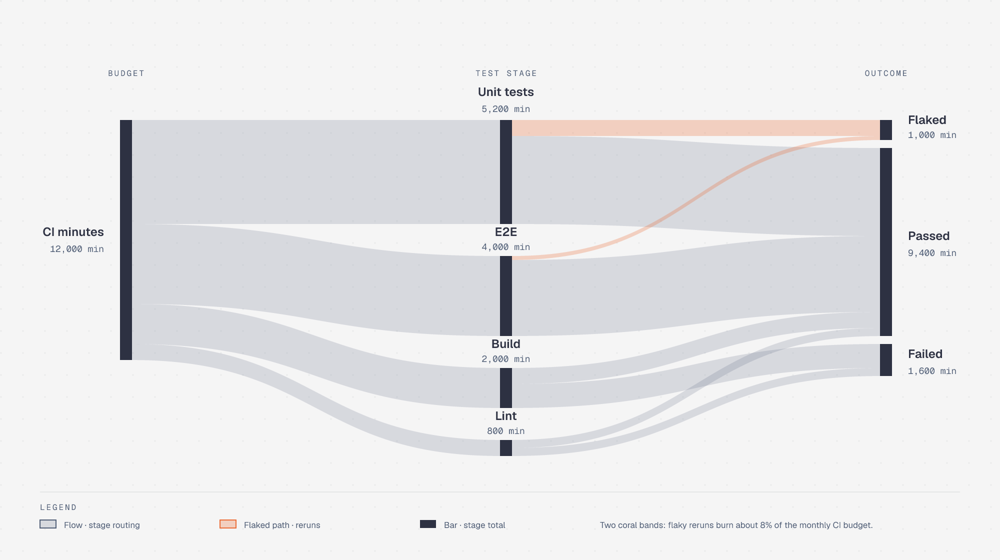
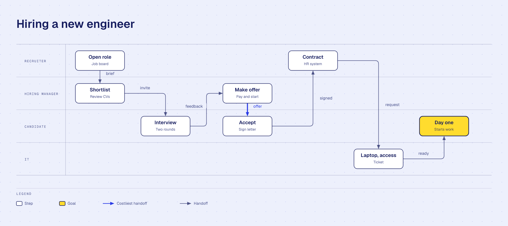
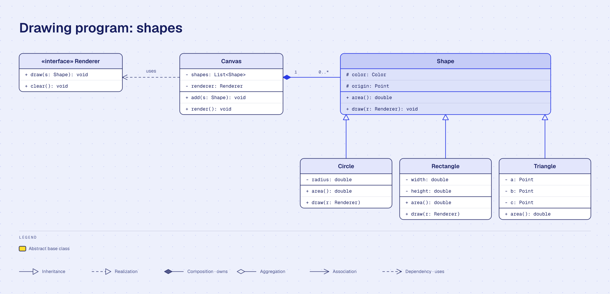
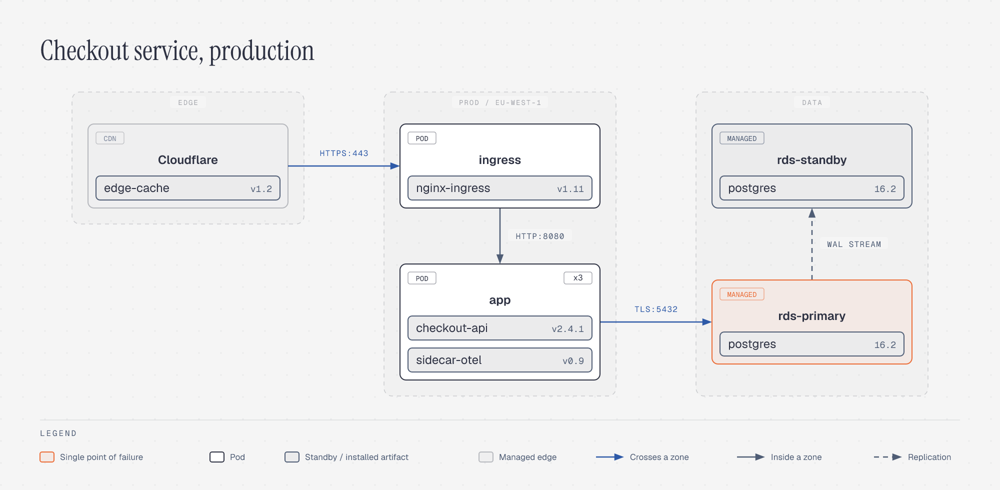
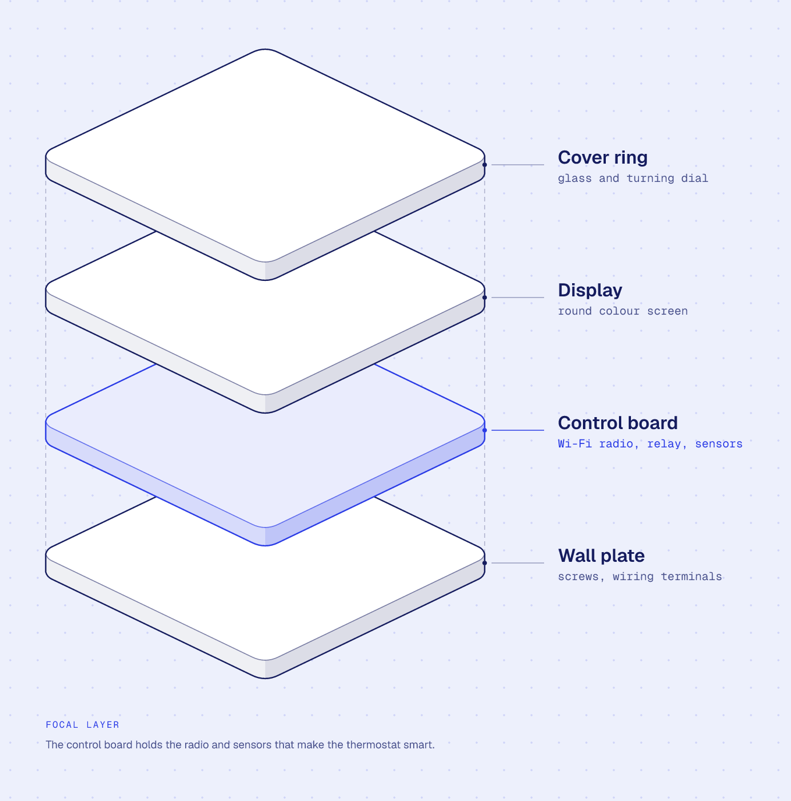

<div align="center">


# FastDraw

**Diagrams that an AI agent writes and a person can edit.**

An agent writes a diagram as a small text file and places every element itself. A person opens
the same file in a browser editor, changes anything on a free canvas, and the change is saved
back as a small edit to the text. Neither side has to redo the other's work.

[A first diagram](#a-first-diagram) · [Getting started](#getting-started) · [Commands](#the-command-line-tool) · [Agents](#using-it-with-an-agent) · [Editor](#the-editor) · [Looks](#looks) · [Gallery](#gallery)


</div>

> **Status: proof of concept.** The language, the tool and the editor all work, but nothing is
> published as a package yet and details may change.

## What you get

- **A text format agents can get right.** A `.fdraw` file has one statement per line, with exact
  coordinates. There is no automatic layout to fight, so what the agent writes is what is drawn.
- **A checker that reads the picture.** `fastdraw check` reports overlapping boxes, arrows that
  cross a box, labels that collide and text that does not fit, each with a line number.
- **Looks.** A `.look` file holds named styles, colours, fonts and icons, so a team decides once
  how its diagrams are drawn. The same diagram can be drawn with another look.
- **A visual editor.** A static site with no server. It edits the same text file and keeps the
  changes minimal, so diffs stay readable.
- **Guides for over forty kinds of diagram.** Architecture, flowchart, sequence, database schema,
  Gantt, Sankey, swimlane and more. Each guide tells an agent how to compose that kind well.
- **Pictures you can reopen.** Exported PNG and SVG files carry the diagram and its look inside
  them. Drop one on the editor to keep editing. The editor's Export dialog (Ctrl+Shift+E) picks
  PNG or SVG, a scale from 1x to 4x, a see-through background, and whether the diagram goes
  inside; it downloads the image or copies it to the clipboard.

## A first diagram

```
shopper: external "Shopper" at 40,60
api:     focal "Orders API" sub="REST" at 296,60
db:      store "Orders DB" at 552,56

shopper -> api "HTTPS" style=link
api -> db "writes" style=primary

legend at 40,172 external="Outside what you own" focal="The service this is about" store="Holds data"
```

<p align="center">
  
</p>

This file is [`assets/example.fdraw`](assets/example.fdraw). It names no look, so it is drawn
with the built-in one.

## Getting started

FastDraw needs Node 20 or later. The command-line tool runs through `npx`, so nothing needs installing:

```
npx fastdraw setup                          # tell this repo's coding agents about FastDraw
npx fastdraw check  docs/example.fdraw      # report problems, with line numbers
npx fastdraw render docs/example.fdraw      # write a PNG next to the file
npx fastdraw open   docs/example.fdraw      # edit it in the browser; changes save back
```

The editor is at https://fastdraw.dev/edit/. Agents that read the web can learn the language from
https://fastdraw.dev/llms.txt with no setup at all.

To work on FastDraw itself (needs Node 22.18 or later, because the sources run as TypeScript directly):

```
git clone https://github.com/coccor/fastdraw.git
cd fastdraw
npm install
bin/fastdraw check assets/example.fdraw
npm run dev                                  # the website and editor, at http://localhost:5199
```

## The command-line tool

| Command | What it does |
|---|---|
| `fastdraw check <file.fdraw>` | Report problems, with line numbers |
| `fastdraw render <file.fdraw> [-o out.png\|.svg] [--scale 2] [--transparent] [--no-embed]` | Draw the diagram (PNG by default). `--transparent` leaves out the page colour and dots; `--no-embed` leaves the diagram out of the image |
| `fastdraw guide [topic]` | Print the language guide, or the guide for one kind of diagram |
| `fastdraw guide list` | List the kinds of diagram that have a guide |
| `fastdraw sizes [file]` | List a look's styles and their sizes (the built-in look when no file is given) |
| `fastdraw icons [file.look] [word]` | List the icons a look offers, or search them by name or meaning (`email` finds `mail`) |
| `fastdraw init-look [path]` | Write the built-in look to a file, to start your own |
| `fastdraw preview-look [file.look]` | Draw every style of a look on one sheet |
| `fastdraw setup [claude\|agents\|copilot] [--global]` | Tell a repo's coding agents about FastDraw: a Claude Code skill, a section in `AGENTS.md`, or in Copilot's instructions. With no name, sets up the agents the repo already uses. Running it again updates them |
| `fastdraw open <file.fdraw> [--editor URL]` | Open the diagram in the web editor with its look, fonts and icons; edits there save back to the file. Runs until Ctrl-C |

## Using it with an agent

An agent needs only the `fastdraw` command. `fastdraw guide` teaches it the language and the way
of working: write the file, run `check` until it is clean, then render and look at the picture.

| Agent | What to do |
|---|---|
| Claude Code | `npx fastdraw setup claude` (adds `.claude/skills/fastdraw/`; `--global` for every repo) |
| Codex, OpenCode | `npx fastdraw setup agents` (adds a section to `AGENTS.md`) |
| GitHub Copilot | `npx fastdraw setup copilot` (adds a section to `.github/copilot-instructions.md`) |
| Chat assistants | Ask it to read https://fastdraw.dev/llms.txt first, or paste that file in; then paste the reply into the editor with "Paste diagram text" |

More detail is in [`agents/README.md`](agents/README.md).

## The editor

<p align="center">
  
</p>

In Chrome and Edge the editor saves in place and re-reads the file about once a second, so an
agent and a person can work on the same diagram at the same time. Other browsers keep changes in
memory and download the result. Nothing is uploaded; there is no server.

`fastdraw open diagram.fdraw` is the one-step way in, in any browser: it lends the diagram's folder
to the editor at https://fastdraw.dev/edit/ from a small server on `127.0.0.1` (a random link, answered
only for the editor's own address), opens the browser at the diagram, and writes edits back to the
`.fdraw` file. The files never leave the computer. Chrome may ask once to let the page reach apps
on this device. `--editor http://localhost:5173/` points it at a local editor instead.

`npm run build:editor` writes the website to `dist-editor/` as a static site you can host anywhere: the
landing page at `/`, the editor at `/edit/`, and the guide for agents at `/llms.txt` and `/guide/<kind>.md`.

## Looks

A look is a text file of named styles. Start from the built-in one and change anything:

```
bin/fastdraw init-look team.look
bin/fastdraw preview-look team.look
```

A diagram picks its look with one line, `look "./team.look"`, or names one that ships with FastDraw:
`look headline`, `look night`, `look reference`, `look sketch`, `look whiteboard`, or one of six styles of drawing:
`look shade`, `look engraved`, `look keys`, `look transit`, `look offset`, `look listing`. In the editor, the **Look** button
previews the diagram in each one before you keep it. A look can also bring its own fonts
(`fontdir`) and colour icons (`icondir`). `fastdraw guide look` explains the format.

## Gallery

All of these were written by agents from the guides alone. Sources are in
[`examples/kinds/`](examples/kinds); they are drawn here with `looks/reference.look`.

| | | |
|:---:|:---:|:---:|
| <br>Sankey | <br>Database schema | <br>Swimlane |
| <br>UML class | <br>Deployment | <br>Exploded layers |

## Repository layout

| Path | What it is |
|---|---|
| `src/` | Core: parser, look loader, arrow router, SVG renderer, checker, text-edit operations |
| `src/cli.ts`, `bin/fastdraw` | The command-line tool |
| `guide/` | What an agent reads to learn the language and how to compose each kind of diagram |
| `src/defaultLook.ts` | The built-in look, used when a diagram names none |
| `agents/` | Thin instruction files that point coding agents at `fastdraw guide` |
| `looks/reference.look` | Test look that mirrors diagram-design's default palette, for quality comparison |
| `looks/whiteboard.look` | Whiteboard: an online-whiteboard look with pastel sticky notes, white rounded shapes, curved connectors and one blue accent. Samples in `examples/whiteboard/` |
| `looks/night.look` | Night: the built-in look after dark, on a deep navy page with the same styles, so a diagram can switch with one line |
| `looks/shade.look`, `engraved.look`, `keys.look`, `transit.look`, `offset.look`, `listing.look` | Six styles of drawing: a hatched shadow, an engraved plate, keycaps, a transit map, two inks out of register, a printout on listing paper. Written by `tools/gen-style-looks.py` |
| `looks/headline.look` | Headline: serif headline over flat newspaper-graphics blocks, one muted crimson accent. An alternative to the built-in look |
| `editor/` | The browser editor (Vite + React) |
| `examples/` | Diagrams written by agents from the guides, and looks used in tests |
| `compare/` | Renders next to the diagram-design originals, plus editor screenshots |
| `fonts/` | Geist, Geist Mono and Newsreader (the built-in look), Libre Franklin and Instrument Serif (SIL Open Font License, texts included) |
| `assets/` | The icon, and the diagrams shown on this page with their sources |
| `test/`, `e2e/` | Core tests and editor tests |

## Development

```
npm test              # core tests
npm run typecheck
npm run test:e2e      # editor tests (Playwright)
npm run build:editor  # static site in dist-editor/
```

## Credits

The kinds of diagram FastDraw has guides for, and many of the composition ideas in those guides
(how few elements to use, one accent, legends, what makes each kind read well), follow
[diagram-design](https://github.com/cathrynlavery/diagram-design) by Cathryn Lavery (MIT licence,
copyright (c) 2025 Cathryn Lavery). The guides are written anew for FastDraw's language. The
pictures in `compare/kinds/*-ref.png` are renders of diagram-design's own example pages, kept for
side-by-side comparison; `looks/reference.look` mirrors its default palette for the same purpose.

The bundled icons (`src/iconSet.ts` and `src/iconSetAll.ts`, built by `tools/phosphor-icons.mjs`) are
[Phosphor Icons](https://phosphoricons.com) (MIT licence, copyright (c) 2023 Phosphor Icons), all of them, in its
thin, light, regular, bold, fill and duotone weights; the licence is in `licenses/phosphor-icons.txt`.
About 130 have friendly names (`database`, `load-balancer`) and are always loaded; the rest keep Phosphor's own
names (`anchor`) and are loaded when a diagram or the editor's icon dialog needs them.
