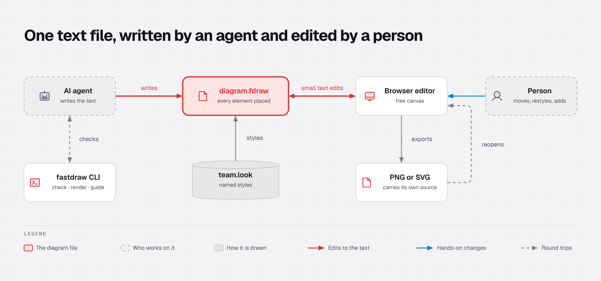
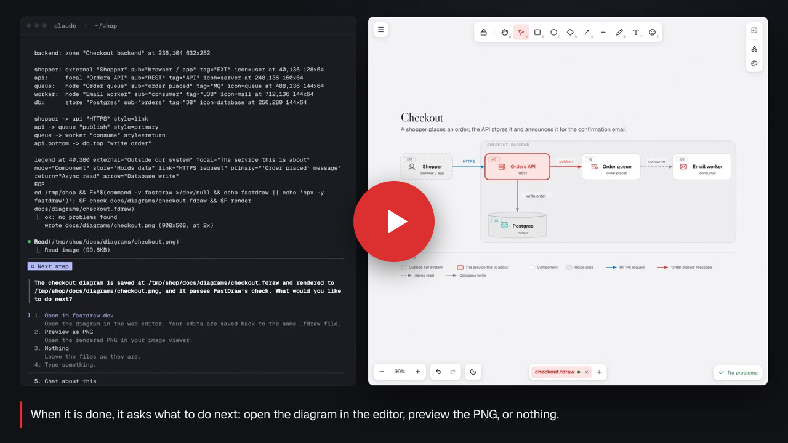
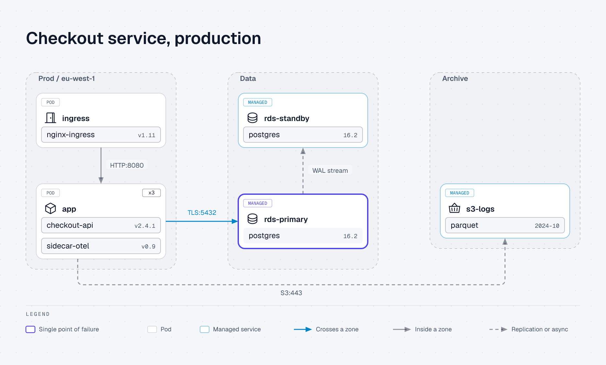
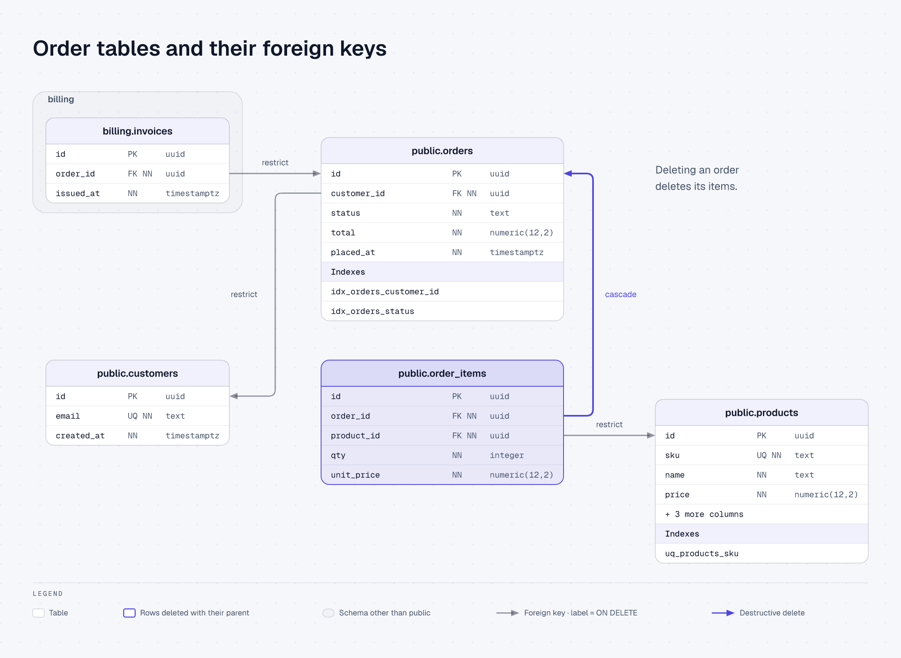
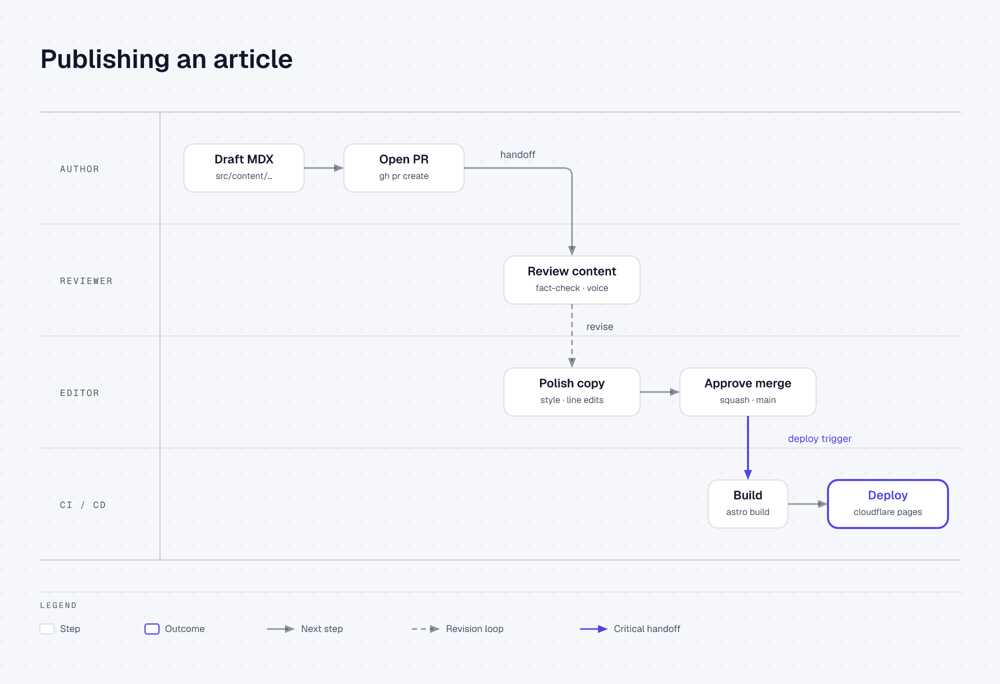

<div align="center">


# FastDraw

[](https://www.npmjs.com/package/fastdraw)
[](https://github.com/coccor/fastdraw/actions/workflows/ci.yml)
[](LICENSE)

</div>

FastDraw is a diagram format and set of tools for diagrams that AI coding agents write and people
edit. A diagram is a `.fdraw` text file with one element per line and exact coordinates. The
`fastdraw` command checks the file and renders it to PNG or SVG. The browser editor at
[fastdraw.dev/edit](https://fastdraw.dev/edit/) opens the same file and saves changes back to it as
small text edits, so the file stays readable in a diff.

<p align="center">
  
</p>

## Demo

A recording of a real session, with the time spent waiting for Claude cut out. A person asks Claude Code
for a checkout diagram, then for a Redis cache, a Stripe payment and a look of their own; the editor
redraws the file after each change. Then they move boxes and add one in the editor, and each edit is
saved into the same file. Click the picture to play the [video](https://fastdraw.dev/demo.mp4).

<p align="center">
  <a href="https://fastdraw.dev/demo.mp4"></a>
</p>

## Example

```
shopper: external "Shopper" at 40,60
api:     focal "Orders API" sub="REST" at 296,60
db:      store "Orders DB" at 552,56

shopper -> api "HTTPS" style=link
api -> db "writes" style=primary

legend at 40,172 external="Outside what you own" focal="The service this is about" store="Holds data"
```

<p align="center">
  
</p>

There is no automatic layout: what the file says is what is drawn. `fastdraw check` reports
overlapping boxes, arrows that cross a box, colliding labels and text that does not fit, each with a
line number, so an agent can fix its own layout before anyone looks at it.

## Getting started

FastDraw needs Node 20 or later. Install the skill for your coding agent once; it then works in every
repository.

**Claude Code**, typed in a session:

```
/plugin install fastdraw --marketplace coccor/fastdraw
```

On Claude Code older than 2.1.275, run `/plugin marketplace add coccor/fastdraw`, then
`/plugin install fastdraw@fastdraw`.

**Codex, OpenCode, Cursor and other agents**, in a terminal:

```
npx skills add coccor/fastdraw -g
```

It asks which of your agents to install for. Without `-g` the skill goes into the current repository
instead, for a team to commit.

**GitHub Copilot** reads only its instructions file, so run this in the repository:
`npx fastdraw setup copilot`. Chat assistants without a shell can read the language from
https://fastdraw.dev/llms.txt.

Then ask your agent for a diagram. It runs the command-line tool through `npx`, so there is nothing
else to install:

```
npx fastdraw check  docs/example.fdraw  # report problems, with line numbers
npx fastdraw render docs/example.fdraw  # write example.png next to the file
npx fastdraw open   docs/example.fdraw  # edit in the browser; changes save to the file
```

### Updating

The skill is short: it tells the agent to run `fastdraw guide`, and the guide, the kinds of diagram, the
looks, `check` and `render` all come from the fastdraw that runs. Through `npx fastdraw` that is the
newest release, so most of an update arrives by itself. The skill itself updates with
`/plugin marketplace update fastdraw` in Claude Code (or turn on auto-update for the fastdraw marketplace
under `/plugin`), and with `npx skills update` elsewhere.

Files written by `npx fastdraw setup` (an older way to install, still used for Copilot) carry the version
that wrote them. When they are older than the fastdraw running, `fastdraw guide` starts with a note asking
the agent to tell you; run `npx fastdraw@latest setup` in the repository to update them.

If fastdraw is installed on the PATH (`npm install -g fastdraw`), agents use that copy instead of `npx`.
`fastdraw guide` checks npm for a newer release at most once a day and says so when there is one; update
with `npm install -g fastdraw@latest`. Set `FASTDRAW_NO_UPDATE_CHECK=1` to turn the check off; it is off on CI.

## Features

- **Checker.** Finds layout problems by measuring the drawn picture, not just parsing the text.
- **Editor.** Move, resize, restyle and add elements on a canvas. In Chrome and Edge it edits the
  file in place while an agent works on it. Nothing is uploaded.
- **Looks.** A `.look` file holds named styles, colours, fonts and icons. Twelve ship with
  FastDraw, including the built-in one, and a team can write its own.
- **Guides for over forty kinds of diagram**, including architecture, flowchart, sequence,
  database schema, Gantt, Sankey and swimlane. Agents read them with `fastdraw guide`.
- **Exports that reopen.** PNG and SVG files carry the diagram source, so dropping one on the
  editor opens it for editing.
- **Embedding.** Show a diagram as a live drawing on a docs site with `<fastdraw-diagram>`, or as
  an SVG image in a GitHub README.
- **draw.io.** `fastdraw render x.fdraw -o x.drawio` writes a draw.io file whose boxes, lines and texts
  draw.io can edit, for Confluence pages and other places that take draw.io.
- **VS Code.** A preview beside the `.fdraw` file that redraws as you type, with `check`'s problems
  in the Problems panel. Click an element in the preview to go to its line.

## Gallery

Written by agents from the guides alone and drawn in the built-in look; sources are in
[`examples/kinds/`](examples/kinds).

| | | |
|:---:|:---:|:---:|
| <br>Deployment | <br>Database schema | <br>Swimlane |

## Documentation

- [Command-line tool](docs/cli.md): every command and option, and setup for each coding agent
- [Editor](docs/editor.md): editing in the browser and `fastdraw open`
- [VS Code extension](vscode/README.md): the preview and Problems panel, and building it
- [Looks](docs/looks.md): the bundled looks and writing your own
- [Showing diagrams on other sites](docs/embedding.md): `<fastdraw-diagram>` and GitHub images
- The language: `npx fastdraw guide`, or https://fastdraw.dev/llms.txt

FastDraw is at version 0.x, and details of the language may still change.

## Rust

[`fastdraw-render`](crates/fastdraw-render) is the renderer as a Rust crate, for applications that draw
diagrams without Node. It draws the same SVG as the npm package of the same version, character for character;
CI checks that on Linux and Windows. See its [README](crates/fastdraw-render/README.md).

## Contributing

See [CONTRIBUTING.md](CONTRIBUTING.md) for building from source, running the tests and the
repository layout.

## License

MIT. See [LICENSE](LICENSE).

The kinds of diagram FastDraw has guides for, and many of the composition ideas in them, follow
[diagram-design](https://github.com/cathrynlavery/diagram-design) by Cathryn Lavery (MIT licence,
copyright (c) 2025 Cathryn Lavery); the guides are written anew for FastDraw's language, and
`looks/reference.look` and `compare/kinds/*-ref.png` mirror it for side-by-side comparison. The
bundled icons are [Phosphor Icons](https://phosphoricons.com) (MIT licence, copyright (c) 2023
Phosphor Icons); the licence is in `licenses/phosphor-icons.txt`. The fonts are under the SIL Open
Font License, with texts in `fonts/`.
