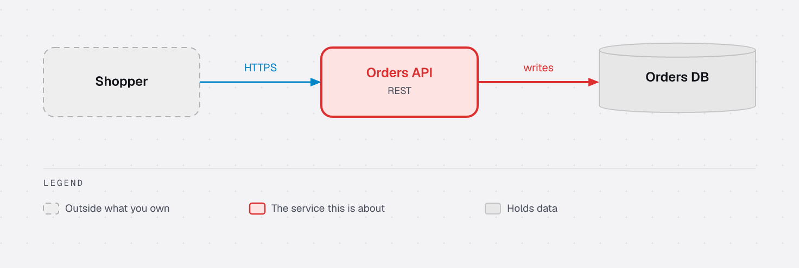
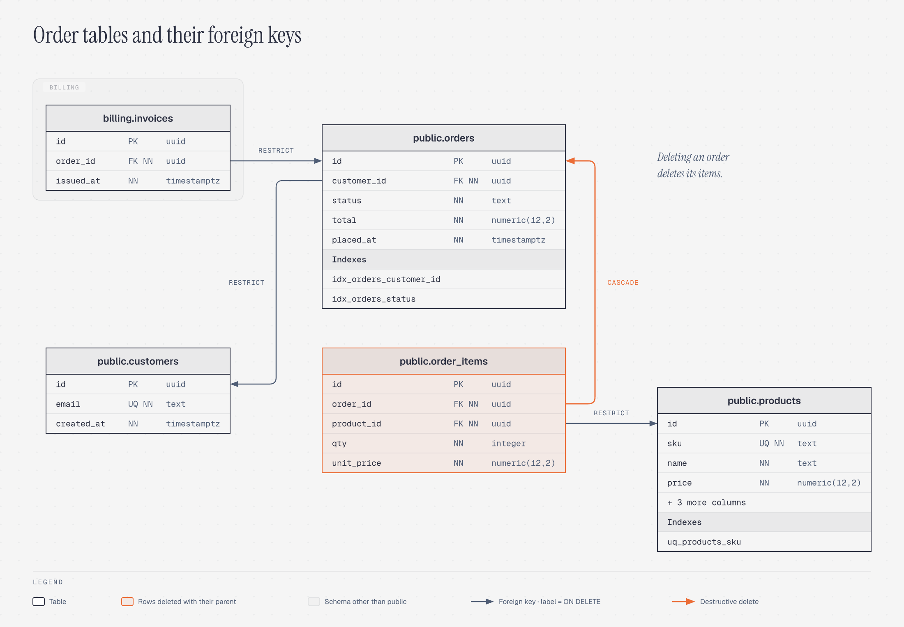

<div align="center">


# FastDraw

[](https://www.npmjs.com/package/fastdraw)
[](https://github.com/coccor/fastdraw/actions/workflows/ci.yml)
[](LICENSE)

</div>

FastDraw is a diagram format and set of tools for diagrams that AI coding agents write and people
edit. A diagram is a `.fdraw` text file with one element per line and exact coordinates. The
`fastdraw` command checks the file and renders it to PNG or SVG. The browser editor at
[fastdraw.dev/edit](https://fastdraw.dev/edit/) opens the same file and saves changes back to it as
small text edits, so the file stays readable in a diff.

<p align="center">
  
</p>

## Example

```
shopper: external "Shopper" at 40,60
api:     focal "Orders API" sub="REST" at 296,60
db:      store "Orders DB" at 552,56

shopper -> api "HTTPS" style=link
api -> db "writes" style=primary

legend at 40,172 external="Outside what you own" focal="The service this is about" store="Holds data"
```

<p align="center">
  
</p>

There is no automatic layout: what the file says is what is drawn. `fastdraw check` reports
overlapping boxes, arrows that cross a box, colliding labels and text that does not fit, each with a
line number, so an agent can fix its own layout before anyone looks at it.

## Getting started

FastDraw needs Node 20 or later.

```
npx fastdraw setup                      # add FastDraw instructions for this repo's coding agents
npx fastdraw check  docs/example.fdraw  # report problems, with line numbers
npx fastdraw render docs/example.fdraw  # write example.png next to the file
npx fastdraw open   docs/example.fdraw  # edit in the browser; changes save to the file
```

`fastdraw setup` supports Claude Code, Codex, OpenCode and GitHub Copilot. Chat assistants without a
shell can read the language from https://fastdraw.dev/llms.txt.

## Features

- **Checker.** Finds layout problems by measuring the drawn picture, not just parsing the text.
- **Editor.** Move, resize, restyle and add elements on a canvas. In Chrome and Edge it edits the
  file in place while an agent works on it. Nothing is uploaded.
- **Looks.** A `.look` file holds named styles, colours, fonts and icons. Twelve ship with
  FastDraw, including the built-in one, and a team can write its own.
- **Guides for over forty kinds of diagram**, including architecture, flowchart, sequence,
  database schema, Gantt, Sankey and swimlane. Agents read them with `fastdraw guide`.
- **Exports that reopen.** PNG and SVG files carry the diagram source, so dropping one on the
  editor opens it for editing.
- **Embedding.** Show a diagram as a live drawing on a docs site with `<fastdraw-diagram>`, or as
  an SVG image in a GitHub README.

## Gallery

Written by agents from the guides alone; sources are in [`examples/kinds/`](examples/kinds).

| | | |
|:---:|:---:|:---:|
| <br>Sankey | <br>Database schema | <br>Swimlane |

## Documentation

- [Command-line tool](docs/cli.md): every command and option, and setup for each coding agent
- [Editor](docs/editor.md): editing in the browser and `fastdraw open`
- [Looks](docs/looks.md): the bundled looks and writing your own
- [Showing diagrams on other sites](docs/embedding.md): `<fastdraw-diagram>` and GitHub images
- The language: `npx fastdraw guide`, or https://fastdraw.dev/llms.txt

FastDraw is at version 0.x, and details of the language may still change.

## Contributing

See [CONTRIBUTING.md](CONTRIBUTING.md) for building from source, running the tests and the
repository layout.

## License

MIT. See [LICENSE](LICENSE).

The kinds of diagram FastDraw has guides for, and many of the composition ideas in them, follow
[diagram-design](https://github.com/cathrynlavery/diagram-design) by Cathryn Lavery (MIT licence,
copyright (c) 2025 Cathryn Lavery); the guides are written anew for FastDraw's language, and
`looks/reference.look` and `compare/kinds/*-ref.png` mirror it for side-by-side comparison. The
bundled icons are [Phosphor Icons](https://phosphoricons.com) (MIT licence, copyright (c) 2023
Phosphor Icons); the licence is in `licenses/phosphor-icons.txt`. The fonts are under the SIL Open
Font License, with texts in `fonts/`.
