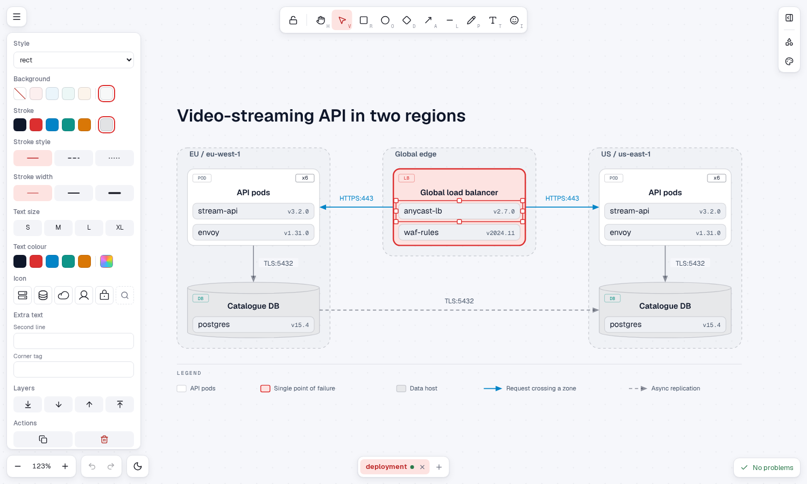

# Editor

The editor runs in the browser at https://fastdraw.dev/edit/. It is a static site with no server: it reads and writes `.fdraw` files on your computer.

  

In Chrome and Edge the editor saves in place and re-reads the file about once a second, so an
agent and a person can work on the same diagram at the same time. Other browsers keep changes in
memory and download the result. Nothing is uploaded; there is no server.

`fastdraw open diagram.fdraw` is the one-step way in, in any browser: it lends the diagram's folder
to the editor at https://fastdraw.dev/edit/ from a small server on `127.0.0.1` (a random link, answered
only for the editor's own address), opens the browser at the diagram, and writes edits back to the
`.fdraw` file. The files never leave the computer. Chrome may ask once to let the page reach apps
on this device. `--editor http://localhost:5173/` points it at a local editor instead.

`npm run build:editor` writes the website to `dist-editor/` as a static site you can host anywhere: the
landing page at `/`, the editor at `/edit/`, `embed.js` (below), and the guide for agents at `/llms.txt`
and `/guide/<kind>.md`.
