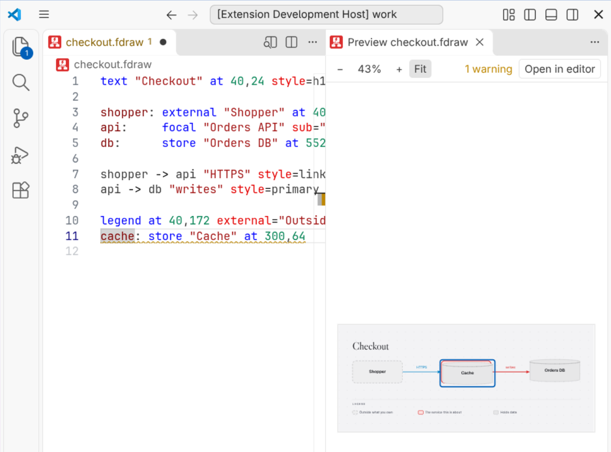

# FastDraw for VS Code

A live preview of [FastDraw](https://fastdraw.dev) diagrams (`.fdraw` files) next to their text, with
`fastdraw check`'s problems in the Problems panel.

<p align="center">
  
</p>

## What it does

- **Opens as the diagram.** A `.fdraw` file opens as its drawing, since an agent usually writes the
  text. **Source** in its toolbar (or the button at the top right) puts the text beside it. It redraws
  as the file changes, uses the same renderer as `fastdraw render`, so it shows what the PNG will show.
  To open `.fdraw` files as text instead, add this to your settings, or use **Reopen Editor With…**
  for one file:

  ```json
  "workbench.editorAssociations": { "*.fdraw": "default" }
  ```

- **Preview beside the text.** With the text open, **FastDraw: Open Preview to the Side** (`Ctrl+K V`,
  or the preview button at the top right) shows the drawing next to it, redrawn as you type, before you
  save. Fit fills the view; 100% draws the diagram at its own size, one point per unit, as the editor does.
- **Click to find the line.** Click a box, a line or a piece of text in the preview to put the cursor
  on the line that draws it. The box on the line the cursor is on is outlined in the preview.
- **Problems.** What `fastdraw check` reports (overlapping boxes, arrows through boxes, colliding
  labels, text that does not fit) appears in the Problems panel and as squiggles on the lines, updated
  as you type. A problem in a `.look` file next to the diagram goes on that file.
- **Light and dark.** In a dark VS Code theme the preview draws the diagram in its look's dark version,
  as `fastdraw render --dark` does. The `fastdraw.preview.theme` setting fixes it to light or dark.
- **Open in the editor.** The **Open in editor** button opens the diagram in the FastDraw editor in the
  browser, as `fastdraw open` does. Edits there save to the file, and the preview follows them. The
  editor gets only that diagram and the files it needs (its look file, the look's dark look, their
  fonts and icons), never other files in the folder and never anything outside the workspace folder.
  The first time, it asks which editor to use, unless `fastdraw open` already saved an answer on this
  computer: the **hosted** editor at fastdraw.dev (recommended: the full icon set, a dark theme, a look
  picker with looks from GitHub, and templates), or the **local** one the extension serves itself, which
  works offline and sends nothing to fastdraw.dev (24 icons in its picker, light theme only, no look
  picker or templates). The answer goes into the `fastdraw.editor` setting.
- Syntax colouring for `.fdraw` and `.look` files.

Icons and fonts a look names by web address are fetched once and kept in the same cache folder the
`fastdraw` command uses. Nothing else leaves the computer, except when you choose Open in editor with the
hosted editor: then the browser loads the editor from fastdraw.dev and reads the files from a server on
`127.0.0.1`. The local editor is served from that same server, so nothing is asked of fastdraw.dev.

## Settings

| Setting | Default | What it does |
|---|---|---|
| `fastdraw.preview.theme` | `auto` | `auto` follows the VS Code theme; `light` always draws the diagram's own look; `dark` always draws its dark version |
| `fastdraw.editor` | `ask` | `hosted` or `local`: which editor Open in editor uses; `ask` asks the first time (or follows what `fastdraw open` saved here) and stores the answer here |
| `fastdraw.editorUrl` | `https://fastdraw.dev/edit/` | The hosted editor's address, when that is the one used, like `fastdraw open --editor <address>` |

## Building from source

```
cd vscode
npm ci
npm run build              # dist/extension.js
npm test                   # the core and the preview page, in Node and Chromium
npm run test:integration   # the extension inside VS Code (downloads VS Code; VSCODE_PATH uses an installed one)
npm run package            # fastdraw-<version>.vsix
```

The extension bundles FastDraw's own sources from `../src`, so it draws with the version of FastDraw in
the same commit.

## Releasing

Set `version` in `vscode/package.json`, merge, then push a tag `vscode-v<version>`:

```
git tag vscode-v0.1.0 && git push origin vscode-v0.1.0
```

`.github/workflows/vscode-release.yml` runs the tests, publishes the `.vsix` to the VS Code Marketplace
and to Open VSX (trusted publishing on both, no tokens), and attaches it to a GitHub release. The
one-time setup for both stores is at the top of that file.

## License

MIT. The bundled fonts are under the SIL Open Font License and the icons are Phosphor Icons (MIT); the
texts are in `fonts/` and `licenses/`.
